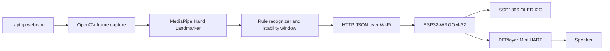

# Smart Glove Based Sign Language to Speech Conversion System

A final-year project demonstrator that uses a laptop webcam and MediaPipe hand landmarks to recognize a small set of explicitly documented demonstration poses. Python sends a validated JSON command over Wi-Fi to an ESP32. The ESP32 updates an SSD1306 OLED and asks a DFPlayer Mini to play the matching MP3 through its speaker. USB serial remains available as a diagnostic fallback.

This webcam mode intentionally removes flex sensors from gesture recognition. It is a pose demonstrator, not complete natural sign-language translation. The rule-based recognizer returns `UNKNOWN` for unsupported or ambiguous poses.

## Architecture



## Project layout

- `python_app/`: webcam, MediaPipe adapter, rule engine, protocol, serial sender, and tests
- `esp32_firmware/`: Arduino sketch and firmware wiring notes
- `assets/models/`: place the official `hand_landmarker.task` model here
- `docs/`: architecture, wiring, troubleshooting, and hardware test procedure

## Requirements

- Windows 10/11, Python 3.11 recommended
- ESP32-WROOM-32
- Laptop webcam
- SSD1306 128x64 I2C OLED at `0x3C`
- DFPlayer Mini, FAT32 microSD card, and speaker
- MPU6050 accelerometer/gyroscope at I2C address `0x68`
- Arduino IDE or PlatformIO with the ESP32 Arduino core

## Windows PowerShell setup

From the project root:

```powershell
py -3.11 -m venv .venv
.\.venv\Scripts\Activate.ps1
python -m pip install --upgrade pip
python -m pip install -r python_app\requirements.txt
python -m unittest discover -s python_app\tests -v
```

Download the official MediaPipe Hand Landmarker model and save it as `assets/models/hand_landmarker.task`. The model is not fabricated or committed. See `assets/models/README.md` for the official source and `docs/troubleshooting.md` for model errors.

## Run

Find the ESP32 COM port in PowerShell:

```powershell
python python_app\main.py --list-ports
python python_app\main.py --transport wifi --esp32-ip 192.168.1.100 --camera 0
```

Set `SMART_GLOVE_WIFI_SSID` and `SMART_GLOVE_WIFI_PASSWORD` in the firmware build configuration before uploading. Use the IP printed by the ESP32 in `--esp32-ip`, or set `SMART_GLOVE_ESP32_IP`. Use `--camera 0` for the built-in webcam, or another index if Windows exposes a different camera. For the preserved USB fallback, use `python python_app\main.py --transport serial --port COM5 --camera 0`.

Press `Q` in the webcam window to quit. Press `R` to close and reconnect the serial port.

## Supported labels

| Label | MP3 |
|---|---:|
| HELLO | 001.mp3 |
| HELP ME | 002.mp3 |
| THANK YOU | 003.mp3 |
| WELCOME | 004.mp3 |
| YES | 005.mp3 |
| HI | 006.mp3 |
| UNKNOWN | no audio |
| NO HAND | no audio |

The exact binary order is `T I M R P`, where `1` means straight/extended and `0` means bent/folded: `01111=HELLO`, `10111=HELP ME`, `11011=THANK YOU`, `11101=WELCOME`, `11110=YES`, and `11111=HI`. The default stability window is five matching frames. A held gesture sends once; a different stable gesture sends once, and returning to the same gesture requires a stable change or release/re-arm.

### Diagnostic overlay and gesture testing

The webcam window shows the stabilized `GESTURE`, each finger's angle and `STRAIGHT`/`BENT` state, and the current `T I M R P` binary pattern. The states come from MediaPipe landmark geometry, not flex-sensor ADC values. `HAND` shows MediaPipe's left/right estimate. `WHY` explains the current raw result, especially an `UNKNOWN` pattern. A label is sent to the ESP32 only after the raw label remains stable for the configured window.

For a repeatable demonstration, use good lighting, show one hand fully inside the frame, keep the palm facing the camera, and hold each pose still until `GESTURE` changes:

- `HELLO`: thumb bent, index/middle/ring/pinky straight (`01111`)
- `HELP ME`: thumb straight, index bent, middle/ring/pinky straight (`10111`)
- `THANK YOU`: thumb/index straight, middle bent, ring/pinky straight (`11011`)
- `WELCOME`: thumb/index/middle straight, ring bent, pinky straight (`11101`)
- `YES`: thumb/index/middle/ring straight, pinky bent (`11110`)
- `HI`: all five fingers straight (`11111`)

Release the hand from the frame between repeated demonstrations. These are explicit project demonstration poses; they are not a claim of complete natural sign-language semantics. If `RAW` is `UNKNOWN`, first inspect `T I M R P` and `WHY`; adjust lighting, palm orientation, or pose before changing thresholds.

## Firmware

Open `esp32_firmware/smart_glove_webcam.ino` in Arduino IDE, select an ESP32-WROOM-32 board and the correct COM port, install the listed libraries, configure the Wi-Fi macros, and upload. The HTTP endpoints are `GET http://ESP32_IP/health`, `GET http://ESP32_IP/i2c`, `GET http://ESP32_IP/test/oled?text=HELLO`, `GET http://ESP32_IP/test/audio?track=1`, and `POST http://ESP32_IP/gesture` with JSON such as `{ "gesture": "HELLO", "pattern": "01111" }`. Wire the board exactly as described in `docs/hardware_connections.md`; especially keep the DFPlayer UART separate from USB serial and use the TX/RX directions shown.

## Frontend app and Vercel deployment

The browser dashboard lives in `webapp/` and is built with React + Vite. It performs gesture detection in the browser using MediaPipe Hand Landmarker and can be pointed at a local ESP32 HTTP endpoint when available.

### Local frontend setup

```powershell
cd webapp
npm install
npm run dev
```

### Production build

```powershell
cd webapp
npm run build
npm run preview
```

### Vercel deployment

1. Push the repository to GitHub.
2. Import the repository in Vercel.
3. Set the framework preset to Vite.
4. Set the build command to `npm run build`.
5. Set the output directory to `dist`.
6. Add any public configuration in `webapp/.env.example` as `VITE_*` environment variables, for example:

```env
VITE_ESP32_BASE_URL=http://192.168.1.20
```

Do not place Wi‑Fi credentials, service-role tokens, or other private secrets in frontend `VITE_*` variables. Vercel hosts the website; it does not host the physical ESP32, OLED, camera, or DFPlayer hardware.

## Testing and limitations

Automated tests cover command validation, Wi-Fi HTTP request construction, track mapping, no-hand handling, conservative unknown handling, and temporal re-arming. Physical camera, MediaPipe model, Wi‑Fi, ESP32, OLED, MPU6050, DFPlayer, SD card, and speaker checks must be performed manually; they have not been claimed as passed by this repository. Follow `docs/hardware_test_procedure.md`.

Known limitations include viewpoint sensitivity, simple rule ambiguity, one-hand input, and no claim of full sign-language vocabulary or semantic accuracy. A trained landmark classifier can replace `classify_landmarks` later without changing the serial or firmware contract.
# IOT-WEB-CAM
