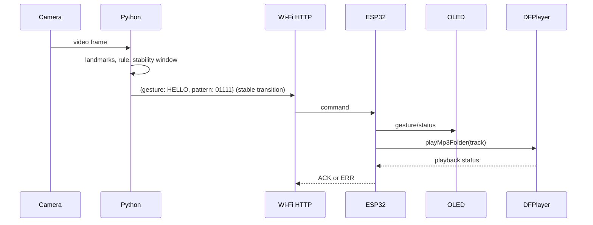

# Architecture and data flow

The application is deliberately split at the protocol boundary:

1. OpenCV captures and mirrors a webcam frame.
2. MediaPipe Hand Landmarker extracts one hand's 21 landmarks.
3. `gesture_recognition.py` applies conservative pose rules.
4. `GestureStabilizer` requires repeated labels, suppresses held-gesture duplicates, and re-arms the same gesture after `NO HAND`.
5. `wifi_communication.py` validates the allow-list and sends one JSON command to `POST /gesture`; USB serial remains an optional fallback.
6. The ESP32 validates again, updates OLED state, and plays the mapped MP3 when available.
7. The MPU6050 is read over the shared I2C bus for health/debug status only; it is not used for gesture classification.

The firmware uses hardware UART 2 for DFPlayer (`RX=26`, `TX=27`) and the default USB serial for Python (`115200`). Flex sensors are not part of this data path.
